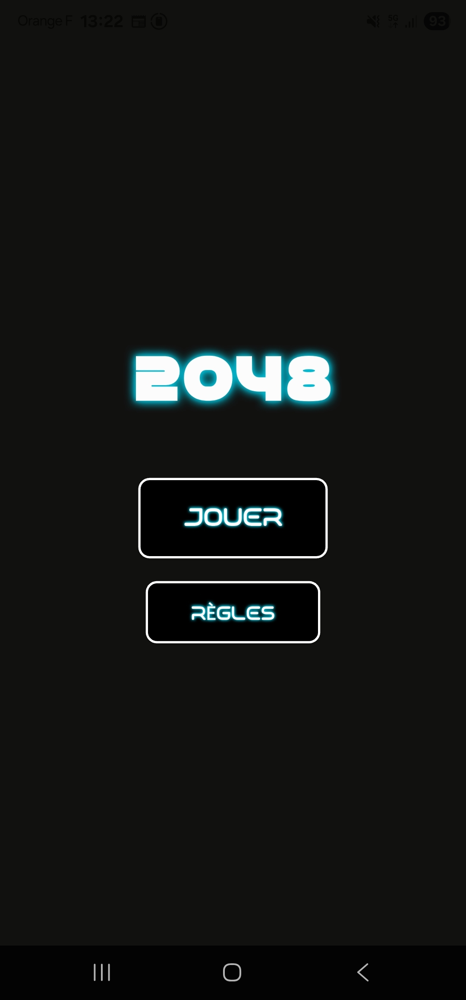
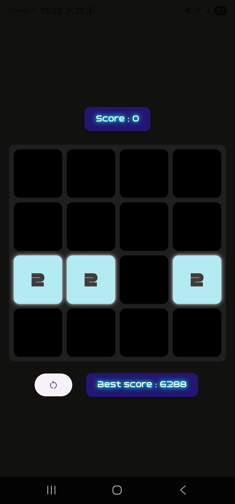

# Twenty-Forty-Eight

A JavaScript implementation of the classic 2048 puzzle game, created before the official release in April 2014.

## Overview

Twenty-Forty-Eight is a sliding puzzle game where the objective is to combine numbered tiles on a 4×4 grid to create a tile with the number 2048. Players slide tiles in four directions, and when two tiles with the same number touch, they merge into one tile with double the value.

## Features

### Core Gameplay

- **4×4 Grid**: Clean, responsive game board with smooth animations
- **Tile Movement**: Swipe or use arrow keys to move tiles in any of the four directions
- **Tile Merging**: Tiles with identical values combine when they collide
- **Smooth Animations**: Fluid tile movements and merge effects

### Game Management

- **Score Tracking**: Real-time current score display with best score persistence
- **Game Over Detection**: Automatic detection when no legal moves remain
- **Restart Function**: Reset button to start a new game at any time
- **Initial Setup**: Game starts with 2-4 randomly placed tiles

### Visual Design

- **Custom Color Scheme**: Distinct colors for different tile values
- **Responsive Layout**: Adapts to different screen sizes
- **Modern UI**: Clean, minimalist design with smooth transitions

## How to Play

1. **Objective**: Combine tiles to reach the 2048 tile
2. **Controls**:
   - Use swipe movements on your phone
3. **Rules**:
   - All tiles slide as far as possible in the chosen direction
   - When two tiles with the same number touch, they merge
   - After each move, a new tile appears in a random empty space
   - The game ends when the grid is full and no moves are possible

## Installation

1. Clone or download the project files
2. Open the project in VS Code
3. Launch the app by pressing **Ctrl + F5** to start in debug mod or execute :
   `flutter run` in the terminal
4. Start playing immediately - no additional setup required

## Technical Implementation

### Architecture

- **Flutter**: Write in dart language and it uses Flutter framework
- **Local Storage**: Best score persistence across sessions

### Key Components

- **Game Grid**: 4×4 matrix data structure for tile management
- **Movement Engine**: Handles tile sliding and collision detection
- **Animation System**: Flutter animations for smooth tile movements
- **Score System**: Real-time scoring with high score tracking

## View

  
   
<i>Home screen</i>

  
   
<i>Game screen</i>

_Created in April 2014 - A tribute to the original 2048 game concept_
